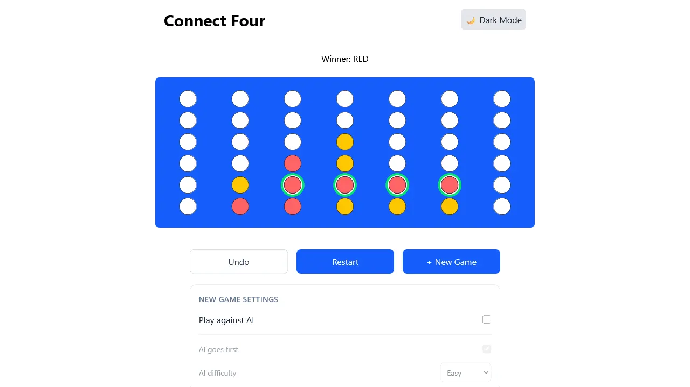

# Connect Four

A modern Connect Four game built with React and TypeScript, featuring a two-player mode and an AI opponent powered by the Minimax algorithm with Alpha-Beta pruning.



## Features

- **Two Game Modes**
  - Player vs. Player — play locally with another player.
  - Player vs. AI — challenge an AI opponent.

- **AI Opponent**
  - Minimax algorithm with Alpha-Beta pruning.
  - Three difficulty levels: Easy, Medium, and Hard.
  - Configurable starting player.

- **Game Controls**
  - Undo the previous move.
  - Restart the current game while preserving its settings.
  - Start a new game with different settings.

- **Interactive Gameplay**
  - Hover preview to see where a disc will land.
  - Animated disc drops.
  - Winning combination highlighting.
  - Game status and result feedback.

- **Accessibility**
  - Respects the user's reduced-motion preference.

## Tech Stack

- React
- TypeScript
- Tailwind CSS
- motion.dev
- Vitest

## AI Implementation

The AI opponent uses the **Minimax algorithm** to evaluate possible moves and select the most promising one.

Alpha-Beta pruning optimizes the search by skipping branches that cannot influence the final decision, reducing the number of positions that need to be evaluated.

The AI evaluates board positions based on factors such as:

- Center column occupancy.
- Potential winning combinations.
- Opportunities to create consecutive discs.
- Threats from the opponent.

Difficulty levels control the search depth:

| Difficulty | Search Depth |
| ---------- | -----------: |
| Easy       |            1 |
| Medium     |            4 |
| Hard       |            6 |

The evaluation function assigns positive scores to positions favorable to the AI and negative scores to positions favorable to the opponent.

## Project Structure

The project separates game logic, AI algorithms, React state management, and UI components.

```text
src/
├── components/
│   └── connect-four/
│       ├── BoardCell.tsx
│       ├── ConnectFour.tsx
│       ├── GameBoard.tsx
│       ├── GameControls.tsx
│       └── GameHeader.tsx
├── hooks/
│   └── useConnectFour.ts
├── lib/
│   └── connect-four/
│       ├── board.ts
│       ├── game.ts
│       └── ai/
│           ├── evaluate.ts
│           └── minimax.ts
└── types/
    └── connect-four/
        ├── board.ts
        ├── config.ts
        ├── game.ts
        └── player.ts
```

### Architecture

- **Game Engine:** Handles board creation, move validation, disc placement, win detection, and game state transitions.
- **AI Engine:** Evaluates board positions and calculates the best move independently of React.
- **Custom Hook:** `useConnectFour` manages game state, actions, configuration, and AI turn orchestration.
- **UI Components:** Render the board, game status, controls, and interactive animations.

The game engine and AI logic are kept independent of the UI, making them easier to test and maintain.

## Getting Started

### Installation

This project uses `node ^24.21.0` and `pnpm ^12.9.1`

Clone the repository:

```bash
git clone <repository-url>
cd <project-directory>
```

Install dependencies:

```bash
pnpm install
```

### Development

Start the development server:

```bash
pnpm run dev
```

### Testing

Run the test suite:

```bash
pnpm run test
```

## Game Rules

Connect Four is a two-player connection game played on a vertical 7-column by 6-row grid.

1. Players take turns dropping colored discs into a column.
2. Discs occupy the lowest available position in the selected column.
3. The first player to connect four discs horizontally, vertically, or diagonally wins.
4. If the board fills without either player connecting four discs, the game ends in a draw.

## License

MIT
